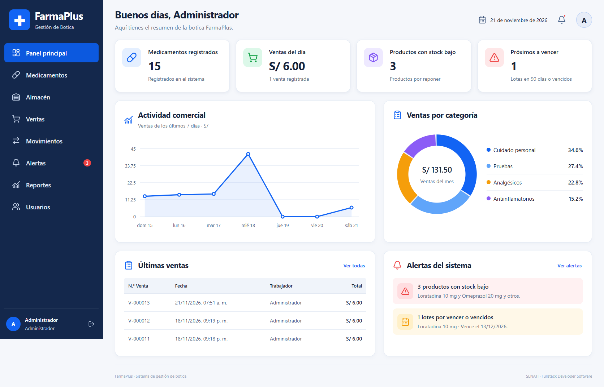
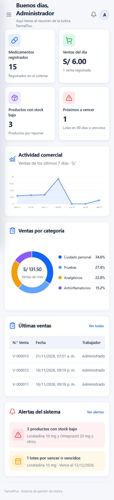

# FarmaPlus

FarmaPlus es un sistema web para la gestión diaria de una botica. Desde una sola plataforma puedes organizar los medicamentos, controlar el inventario, registrar ventas y consultar qué productos necesitan reposición.

## Acerca del proyecto

Cuando las ventas se anotan en un cuaderno y las entradas de almacén en otro, es fácil perder un registro o contar como disponibles unidades que ya se vendieron. FarmaPlus nació como proyecto académico del curso **Fullstack Developer Software** de SENATI para abordar ese problema.

El catálogo, los lotes y las ventas comparten la misma información. Al confirmar una venta, por ejemplo, el sistema descuenta las unidades del lote correspondiente. La interfaz sigue el orden de las tareas de una botica, con secciones como **Medicamentos**, **Almacén** y **Ventas** para que sea fácil encontrar cada operación.

## Funcionalidades principales

| Sección | Qué puedes hacer |
| --- | --- |
| Panel principal | Consultar las ventas del día, la actividad de los últimos siete días y las alertas del sistema. |
| Medicamentos | Registrar y editar medicamentos, su presentación, su precio y la cantidad mínima que conviene mantener. |
| Almacén y movimientos | Registrar entradas, salidas y ajustes. Consultar la cantidad y el vencimiento de cada lote, además del historial de movimientos. |
| Ventas | Registrar una venta y consultar su detalle. Las unidades se descuentan automáticamente, empezando por los lotes vigentes que vencen primero. |
| Alertas | Identificar medicamentos por debajo del mínimo disponible y lotes con unidades que ya vencieron o vencerán en los próximos 90 días. |
| Reportes | Filtrar ventas por fecha, consultar los medicamentos de mayor rotación y descargar resultados en formato CSV. |
| Inicio de sesión y permisos | Acceder con una sesión de administrador. El servidor comprueba la sesión y los permisos antes de permitir cada operación. |

## Tecnologías utilizadas

| Parte del sistema | Tecnologías y función |
| --- | --- |
| Frontend | **React** y **JavaScript** dan vida a las pantallas y formularios. **HTML** y **CSS** definen su estructura y apariencia. **Vite** inicia la interfaz en desarrollo y prepara la versión compilada. |
| Backend | **Node.js** ejecuta el servidor. **Express.js** expone una **API REST** que recibe las operaciones de la interfaz, como registrar una venta o consultar el inventario. |
| Base de datos | **SQLite** guarda los medicamentos, lotes, ventas y movimientos en un archivo local. |

## Capturas de pantalla

**Panel principal en escritorio**



<details>
<summary>Ver el panel principal en un teléfono</summary>



</details>

<!-- Espacios para completar cuando se incorporen las capturas al repositorio.
### Inicio de sesión
![Formulario de inicio de sesión][captura-acceso]

### Gestión de medicamentos
![Catálogo de medicamentos][captura-medicamentos]

### Inventario
![Inventario por lote en Almacén][captura-inventario]

### Registro de ventas
![Formulario de una nueva venta][captura-ventas]
-->

## Instalación y ejecución

1. **Prepara tu equipo.** Instala **Node.js 24.20.0 o superior**, que incluye npm. Necesitarás conexión a internet para la instalación inicial y un navegador para abrir el sistema. [Descargar Node.js](https://nodejs.org/es/download)
2. **Descarga el proyecto.** En GitHub, selecciona **Code → Download ZIP**, extrae el archivo y abre la carpeta que contiene `package.json`, `frontend` y `backend`.
3. **Abre una terminal en esa carpeta.** En Windows puedes escribir `cmd` en la barra de direcciones del Explorador de archivos y pulsar **Enter**.
4. **Instala e inicia FarmaPlus.** Ejecuta estos comandos en orden. Espera a que termine la instalación antes de ejecutar el segundo.

   ```bash
   npm install
   npm run dev
   ```

   Si usas PowerShell en Windows, puedes escribir `npm.cmd install` y `npm.cmd run dev`.

5. **Abre el sistema en tu navegador.** El comando `npm run dev` inicia el frontend y el backend juntos. Mantén la terminal abierta y entra en [http://127.0.0.1:5173](http://127.0.0.1:5173). Si ese puerto está ocupado, usa la dirección que Vite muestra junto a `Local`.

La primera vez se crean medicamentos, lotes y ventas de ejemplo. Para detener el sistema, pulsa **Ctrl+C** en la terminal. Para volver a abrirlo, ejecuta `npm run dev` desde la misma carpeta. Tus registros se conservan en `backend/data/farmaplus.sqlite`.

## Credenciales de demostración

| Usuario | Contraseña |
| --- | --- |
| `admin` | `admin123` |

Introduce estos datos y pulsa **Ingresar al sistema**. Esta cuenta de prueba sirve únicamente para explorar las funcionalidades de la demostración.

## Estructura del proyecto

| Carpeta o archivo | Contenido |
| --- | --- |
| `frontend/` | Pantallas, formularios y estilos. |
| `backend/src/` | Servidor, inicio de sesión y operaciones de inventario y ventas. |
| `backend/data/` | Base de datos local, creada al iniciar el sistema. |
| `backend/test/` y `tests/` | Pruebas del servidor y de los flujos de uso en el navegador. |
| `package.json` | Comandos para iniciar el proyecto desde la carpeta principal. |

## Aviso sobre el proyecto

FarmaPlus se desarrolló con fines educativos y de demostración para mostrar cómo funciona un sistema web de gestión de una botica. Para adaptarlo a un entorno real, será necesario cambiar las credenciales predeterminadas, retirar el apartado **Acceso de demostración** de la pantalla de inicio de sesión y configurar la seguridad del servidor y de las sesiones para ese entorno.
